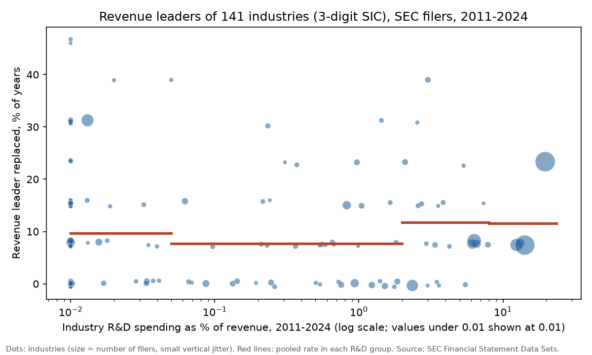
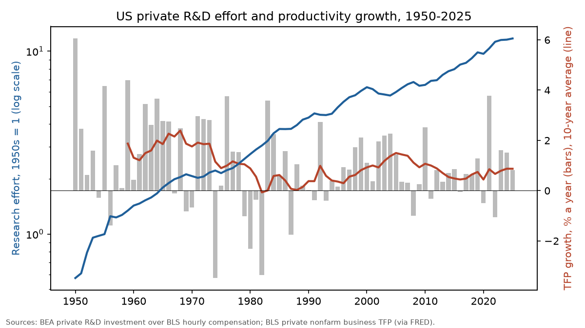

# How Long a Lead Lasts

### In 1992, Philippe Aghion and Peter Howitt modeled economic growth as a chain of innovations, each one ending the monopoly of the one before, so that more research should mean shorter reigns at the top. I checked that against fourteen years of revenue rankings for every company that files annual reports with the SEC.

---

For as long as most people have owned a computer, the largest chip company in America was Intel. In 2021 it sold
$79.0 billion of processors and other chips. Nvidia, a maker of graphics cards, had sold $4.0 billion in the year
to January 2012. In the year to January 2024 Nvidia's revenue reached $60.9 billion and passed Intel's $54.2
billion, and a year later it was $130.5 billion, more than twice Intel's $53.1 billion. The chips that did it,
processors built to train and run neural networks, came out of research Nvidia had been paying for, $7.3 billion of
it in the year to January 2023. Intel spent more on research in every year from 2011 to 2024, $17.5 billion in 2022.

That story has a name. Joseph Schumpeter called it creative destruction, the process by which a new product makes
an old one obsolete and takes its profits along with its customers. Schumpeter wrote about it in words. Two
economists, Philippe Aghion and Peter Howitt, turned it into a model in which every innovation is a new monopoly
that lasts only until the next innovation arrives. Their model makes a prediction a reader can check against
company filings. Where more research is done, the company on top should be knocked off sooner.

Across 141 American industries, the data say that leaders fall about once a decade. They fall a little more often
in industries that spend a fifth of their revenue on research than in industries that spend nothing, but the gap
is small and the data cannot tell it apart from no gap at all.

---

## Two measures

The first measure is how often an industry's revenue leader is replaced. For industry $`j`$, I count $`C_j`$, the
number of years in which the company with the most revenue was not the company that led the year before, and divide
by $`T_j`$, the number of year-to-year transitions observed. The result is an annual hazard, the chance that the
leader loses the top spot in a given year, and its reciprocal is the expected length of a reign.

```math
h_j = \frac{C_j}{T_j}, \qquad \text{expected tenure} = \frac{1}{h_j}
```

From fiscal 2011 to 2024 there are 13 transitions. Semiconductors changed leaders once, when Nvidia passed Intel.
The two big Western railroads, Union Pacific and BNSF, traded first place six times.

```math
\begin{aligned}
h_{\text{chips}} &= \frac{1}{13} = 0.077 \quad (\text{tenure } 13 \text{ years}) \\
h_{\text{rail}} &= \frac{6}{13} = 0.46 \quad (\text{tenure } 2.2 \text{ years})
\end{aligned}
```

The second measure is research intensity, the share of revenue an industry spends on research and development,
added up across all its companies $`i`$ over the fourteen years.

```math
n_j = \frac{\sum_{i \in j} \sum_{t} RD_{it}}{\sum_{i \in j} \sum_{t} Rev_{it}}
```

The electronic-component group in the SEC's codes, an average of 141 companies including Intel and Nvidia, spent
12.4% of its revenue on research. Railroads reported none.

| Research intensity | Typical industries | What the model expects |
|---|---|---|
| Zero | Railroads, car rental, metal cans | Leaders are never displaced |
| 2% to 8% | Aircraft, engines, computers | Displacement now and then |
| 8% or more | Drugs, software, chips, telecom equipment | Frequent displacement, short reigns |

---

## Aghion and Howitt's question

Philippe Aghion was born in Paris in 1956 and earned his doctorate at Harvard in 1987. Peter Howitt was born in
Canada in 1946 and earned his at Northwestern in 1973. When their paper first circulated, as National Bureau of
Economic Research Working Paper 3223 in January 1990, Aghion was at MIT and Howitt at the University of Western
Ontario. It was published in *Econometrica* in March 1992 as "A Model of Growth Through Creative Destruction."

The growth models of the late 1980s, Paul Romer's most of all, explained how ideas could keep an economy growing
forever, but in those models a new product simply joined the old ones on the shelf. Aghion and Howitt built an
economy in which a new product pushes the old one off. Research firms hire workers to look for the next better
version of the economy's intermediate goods. Discoveries arrive at random, as a Poisson process with rate
$`\lambda n`$, where $`n`$ is the amount of labor in research and $`\lambda`$ measures how productive that labor is.
Each discovery makes production more efficient by a factor $`\gamma`$ and is patented. The holder earns a monopoly
profit $`\pi`$ per unit of time until the next discovery replaces it.

The central result follows from assumptions stated in the paper, that the time until the next discovery is
exponentially distributed with rate $`\lambda n`$, that the monopolist discounts at the interest rate $`r`$, that
anyone may enter research at the wage $`w`$, and that each discovery multiplies output $`y`$ by $`\gamma`$. Under
them the value of holding the newest patent and the economy's average growth rate follow in a few lines, with
$`\tau`$ the length of a reign and $`\Delta`$ a stretch of time.

```math
\begin{aligned}
V &= \mathbb{E}\!\left[\int_0^{\tau} \pi e^{-rt}\,dt\right],
  \qquad \tau \sim \text{Exponential}(\lambda n) \\
  &= \int_0^{\infty} \pi e^{-rt}\,\Pr(\tau > t)\,dt
   = \int_0^{\infty} \pi e^{-(r+\lambda n)t}\,dt \\
  &= \frac{\pi}{r + \lambda n} \\
w &= \lambda V \quad \text{(free entry: wage = expected prize)} \\
\mathbb{E}[\ln y_{t+\Delta} - \ln y_t]
  &= \mathbb{E}[\text{discoveries in } \Delta] \cdot \ln \gamma
   = \lambda n \Delta \ln \gamma
\end{aligned}
```

The research being done by everyone else sits in the denominator of the prize. More research shortens every
monopoly, and the expected tenure of the current leader is $`1/(\lambda n)`$. Two conclusions made the paper
famous. The prospect of heavy research tomorrow discourages research today, and a research
firm ignores the profits it destroys when it succeeds, a business-stealing effect that can push a market economy to do
more research than is good for it. Growth itself rises with research effort, with the size of each step and with
the size of the labor force.

The worked example below sets $`\lambda n`$ to the pooled hazard from the data, 9.49% a year, and $`r`$ to the
2011 to 2024 average yield on 10-year inflation-protected Treasury bonds, 0.395%, and compares the result with a
leader that could never be displaced.

```math
\begin{aligned}
\frac{V}{\pi} &= \frac{1}{0.00395 + 0.0949} = 10.1 \text{ years of profit} \\
\frac{V}{\pi}\Big|_{\lambda n = 0} &= \frac{1}{0.00395} = 253 \text{ years of profit}
\end{aligned}
```

The strongest objection came in 1995 from Charles Jones. Because growth in the model rises with the amount of
research, and research effort in the rich economies had multiplied while their growth rates showed no matching
rise, Jones argued that the time series rejected this whole class of models. Aghion and Howitt had seen the
problem coming and called the link between population and growth an "unfortunate implication" in their working
paper. A second line
of criticism came in 2016 from Daniel Garcia-Macia, Chang-Tai Hsieh and Peter Klenow, who used Census records on
every private business and concluded that most American productivity growth comes from established firms improving
their own products rather than from rivals displacing them.

Aghion now holds positions at the Collège de France, INSEAD and the London School of Economics, and Howitt is
at Brown University. In 2025 the Royal Swedish Academy of Sciences gave half of the economics prize
jointly to the two of them "for the theory of sustained growth through creative destruction," and the other half
to the economic historian Joel Mokyr. The question still matters because it decides how governments treat
dominant firms. If research reliably topples incumbents, a dominant firm is a temporary winner. If it does not, dominance can last.

---

## How I tested it

Aghion and Howitt's paper has no data, so there are no sample rules to copy. I used the SEC's Financial Statement
Data Sets, which hold every number tagged in every financial statement filed with the SEC, one file per quarter. I
read all 58 quarterly files from early 2012 to mid-2026 and kept the annual reports (10-Ks). A 10-K reports the
current year and the year before, so these files cover every fiscal year from 2011 to 2024. I label fiscal years the
way the SEC's own data service does, by the calendar year that holds most of the fiscal year. Revenue is the largest
of seventeen standard total-revenue tags a company reports, plus the one label of its own that Exxon Mobil used
before 2017, and R&D is the largest of three R&D tags. A company that tags no R&D is counted as spending none. A
first pass with only five revenue tags dropped HCA, Carnival and Newmont for years and invented changes of leader,
so I widened the list before running the tests.

Each company is placed in the three-digit industry of the Standard Industrial Classification code on its latest
10-K. I set aside, before looking at results, finance, insurance and real estate (where revenue means different
things), regulated electric, gas and water utilities (whose territories are granted, not won) and government and
unclassified codes. An industry needed at least four companies with revenue in every year, which left 141 industries
and an average of 24 companies each. I filled one-year holes inside a company's revenue series, which come from a
missing tag rather than a real absence, and I treated a company that re-registered under a new SEC number, such as
Eaton Corp becoming Eaton Corp plc, Google Inc becoming Alphabet or the old Walt Disney Co becoming the new one, as
the same leader.

The model's monopolist becomes the industry's revenue leader, and the model's research labor $`n`$ becomes research
intensity. The model says the hazard is $`\lambda n`$, a straight line through the origin, so the estimating
equation is a straight line and the test is on its slope.

```math
\begin{aligned}
h_j &= \alpha + \beta\, n_j + \varepsilon_j \\
H_0&:\ \beta = 0, \qquad \text{model: } \alpha = 0,\ \beta = \lambda > 0
\end{aligned}
```

Here $`h_j`$ is in percent a year and $`n_j`$ in percent of revenue, so $`\beta`$ is the extra chance of a leadership
change for each point of revenue spent on research. Standard errors are heteroskedasticity-robust (HC1), since
industries with few companies have noisier hazards. Each industry is one observation, so there are no fixed
effects. I also added controls for the number of companies and revenue growth, fit a Poisson count model, moved to
four-digit industries, counted only changes that lasted, and tried two other outcomes, whether the 2024 leader
differs from the 2011 leader and the share of the 2011 top four that left the top four.

---

## Industry leaders fall about once a decade, with or without research

The 141 industries saw 174 changes of leader in 1,833 industry-years, a pooled hazard of 9.49% a year and an
expected reign of about ten and a half years. In 58 industries the same company led in every year. Grouped by
research intensity, the hazards move a little and not in a straight line.

| Research intensity | Industries | Leader changes | Hazard per year | 95% interval | Expected tenure |
|---|---|---|---|---|---|
| No R&D (under 0.05% of revenue) | 76 | 96 | 9.7% | 7.9% to 11.9% | 10.3 years |
| Some R&D (0.05% to 2%) | 40 | 40 | 7.7% | 5.5% to 10.5% | 13.0 years |
| R&D-intensive (2% to 8%) | 21 | 32 | 11.7% | 8.0% to 16.5% | 8.5 years |
| Research-driven (8% or more) | 4 | 6 | 11.5% | 4.2% to 25.1% | 8.7 years |

The regression puts this in one line. The slope has the sign the model predicts but is small and indistinguishable
from zero, and the intercept, the hazard in an industry with no research at all, is far from the zero the model
requires.

```math
\begin{aligned}
\hat{\beta} &= 0.233 \;(0.230), \quad 95\%\ \text{CI}\ [-0.217,\ 0.683], \quad p = 0.31 \\
\hat{\alpha} &= 9.20 \;(1.05), \quad N = 141
\end{aligned}
```

At its upper bound the interval allows about 0.7 points per point of research intensity. The Poisson count model
gives 0.047 (0.031), $`p = 0.13`$. Counting only changes in which the new leader held on for a second
year gives 0.233 (0.141), $`p = 0.098`$, the closest any hazard measure comes to the model. At the four-digit level
the slope is 0.036 (0.226) across 179 industries. That level has 15 industries above 8% research intensity, enough
to pin down their hazard better, and it comes to 8.7% a year, inside the 8.4% to 10.6% range of the other three
groups.

One measure does point the model's way. Asked only whether the 2024 leader is a different company from the 2011
leader, the answer is yes in 30 of the 76 industries with no research, 17 of 40 and 13 of 21 in the middle groups,
and all four research-driven industries. The slope is 4.3 points per point of research intensity (0.89),
$`p < 0.001`$, and without the four research-driven industries it is 5.1 (2.5), $`p = 0.037`$. At the four-digit
level, with 15 research-driven industries instead of 4, it falls to 0.44 (0.91), $`p = 0.63`$, so the result
depends on how coarsely industries are drawn. Part of the gap is that leaders in industries
without research more often swap places and swap back, as Union Pacific and BNSF did, which counts
as change but leaves the 2011 leader on top. Turnover in the top four shows nothing either way.



In the industries that do the most research, the displacements that did happen look like Schumpeter's.

| Industry | Spent on R&D | Leader changes | What happened |
|---|---|---|---|
| Drugs and biologics | 19.6% | 3 | Johnson & Johnson passed Pfizer in 2012; Pfizer retook the lead in 2022 with its COVID vaccine and treatment, then fell back |
| Software and internet services | 14.2% | 1 | Alphabet passed Microsoft in 2016 and kept the lead |
| Electronic components | 12.4% | 1 | Nvidia passed Intel in the year to January 2024 |
| Computers | 6.6% | 1 | Apple passed HP in 2012 |
| Engines and turbines | 3.5% | 0 | Cummins led every year |
| Construction machinery | 1.85% | 0 | Caterpillar led every year |

Many of the other displacements, including the ones in aircraft, have little to do with discoveries.

| Industry | Spent on R&D | Leader changes | What happened |
|---|---|---|---|
| Railroads | 0% | 6 | Union Pacific and BNSF traded places; in 2011 they were $9 million apart on $19.6 billion of revenue |
| Metal cans | 0% | 6 | Crown Holdings and Ball traded places; in 2024 they were $6 million apart |
| Car rental and leasing | 0% | 5 | Hertz, Avis Budget and Ryder rotated through the top spot |
| Aircraft and parts | 3.0% | 5 | Boeing and United Technologies (now RTX) swapped places after the 737 MAX grounding |
| Oil and gas production | 0% | 4 | Murphy Oil, Occidental, Chesapeake (now Expand Energy) and Devon rose and fell with oil prices, spinoffs and mergers |

In these industries near-ties in revenue, mergers, spinoffs, commodity prices and a grounded airplane did the
moving. In the model, displacement comes only from research. In the data, research is one cause among many.

---

## Research has multiplied while productivity growth has not

Aghion and Howitt's growth formula says the
economy's productivity growth $`g`$ is proportional to research effort. I measure effort as Nicholas Bloom,
Charles Jones, John Van Reenen and Michael Webb did in 2020, as an "effective number of researchers," which I compute
as private R&D spending divided by average hourly compensation, the number of hours of work the research budget
could buy. Productivity is the Bureau of Labor Statistics measure of total factor productivity for the private
nonfarm business sector, the part of output growth not explained by more workers or more machines.

| Decade | Productivity growth per year | Research effort (1950s = 1) | Private R&D as % of GDP | Growth per unit of effort (1950s = 1) |
|---|---|---|---|---|
| 1950s | 1.87% | 1.0 | 0.65% | 1.00 |
| 1960s | 1.87% | 1.8 | 0.98% | 0.57 |
| 1970s | 1.05% | 2.2 | 1.05% | 0.25 |
| 1980s | 0.15% | 3.5 | 1.38% | 0.02 |
| 1990s | 0.82% | 5.0 | 1.64% | 0.09 |
| 2000s | 0.93% | 6.2 | 1.83% | 0.08 |
| 2010s | 0.74% | 8.0 | 2.12% | 0.05 |
| 2020 to 2025 | 1.03% | 11.0 | 2.74% | 0.05 |

Research effort grew elevenfold. Productivity growth in the 2020s ran at a little over half its 1950s pace. In
the model's terms, $`\lambda \ln \gamma`$, the growth each unit of research buys, fell to one-twentieth of its 1950s
value. In the annual regression below, $`g_t`$ is TFP growth in percent in year $`t`$, $`R_t`$ is research effort
and $`u_t`$ is the error. With Newey-West standard errors allowing four years of autocorrelation, the slope has the
opposite sign to the model's.

```math
\begin{aligned}
g_t &= a + b \ln R_t + u_t \\
\hat{b} &= -0.525 \;(0.232), \quad 95\%\ \text{CI}\ [-0.981,\ -0.070], \quad N = 76
\end{aligned}
```

Later Schumpeterian models dropped the scale effect by making growth depend on research as a share of the economy
rather than its level. Private R&D rose from 0.65% to 2.74% of GDP, and the slope
of growth on that share is $`-0.53`$ (0.30), $`p = 0.079`$.



If every leadership change in the filings were one of Aghion and Howitt's
innovations, the measured productivity growth of 2011 to 2024 would imply a small step for each one.

```math
\ln \gamma = \frac{g}{\lambda n} = \frac{0.00735}{0.0949} = 0.0774, \qquad \gamma - 1 = 8.0\%
```

That is a plausible step size, but the first finding shows that many of those changes are not innovations, so the
true steps behind today's growth must be larger and rarer, or come from incumbents improving their own products, as
Garcia-Macia, Hsieh and Klenow argued.

---

## Why it matters

For consumers, the result means that the products in an industry can change faster than the company selling them.
Leadership changed only slightly more often in research-heavy industries than elsewhere, by an amount the data
cannot tell apart from chance, and in engines, construction machinery and farm equipment the 2011 leader was still on
top in 2024, so its customers got their new technology from the incumbent.

For workers, a job at the leading firm in drugs, software or machinery was about as secure, in the sense of the
employer staying on top, as a job at the leading railroad.

For would-be challengers, the ones who reached first place in research-heavy industries, Alphabet, Apple and
Nvidia, were already very large companies when they passed the incumbent.

For policy, the argument that a dominant firm in a research-heavy market will soon be displaced by the next
innovation, common in debates over large technology firms, finds little support in the leadership data. Leaders
in high-research industries held on nearly as long as leaders in industries with no research, so enforcers should
not assume innovation will discipline a dominant firm on its own.

---

## Limits of this study

The SEC data cover only companies that file with the SEC, so private companies and foreign companies that file
under international accounting standards are missing, and an industry's leader here is the largest public
American filer, not always the largest seller in the market. SIC codes are coarse and fixed at each company's latest
filing, so a conglomerate like Johnson & Johnson is placed in one industry for all fourteen years. Revenue rankings
measure size, not technological leadership, and a company can lose the top spot in sales while keeping the best
product, or the reverse. R&D that a company does not tag is counted as zero, and a company that tagged its revenue
only with labels of its own, as D.R. Horton did before 2016, is missing for those years. Mergers and spinoffs count
as changes of leader, which the model does not intend. Fourteen years is a short window for
events the model expects once a decade, and with only four three-digit industries above 8% research intensity the
top group's hazard is imprecise, and the one measure that favors the model holds at the three-digit level and not
at the four-digit level. The national-accounts test compares decades that differ in many ways besides
research, so it shows that growth did not rise with research effort, not why.

---

## Further reading

- [TECHNICAL.md](TECHNICAL.md) has the data, method, every test statistic and how to reproduce the results.
- [results/FINDINGS.md](results/FINDINGS.md) has a plain-English summary and every table the scripts produce.
- [METHODS_REVIEW.md](METHODS_REVIEW.md) is a methods and reporting review of the original paper.
- Philippe Aghion and Peter Howitt, "A Model of Growth Through Creative Destruction," *Econometrica* 60(2),
  March 1992, pp. 323–351; NBER Working Paper 3223, January 1990.
- Charles I. Jones, "R&D-Based Models of Economic Growth," *Journal of Political Economy* 103(4), August 1995,
  pp. 759–784.
- Nicholas Bloom, Charles I. Jones, John Van Reenen and Michael Webb, "Are Ideas Getting Harder to Find?"
  *American Economic Review* 110(4), April 2020, pp. 1104–1144.
- Daniel Garcia-Macia, Chang-Tai Hsieh and Peter J. Klenow, "How Destructive is Innovation?" NBER Working Paper
  22953, 2016.
- US Securities and Exchange Commission, Financial Statement Data Sets, 2012q1 to 2026q2
  (sec.gov/dera/data/financial-statement-data-sets), and the SEC's list of SIC industry codes.
- Federal Reserve Bank of St. Louis, FRED series MFPNFBS (BLS total factor productivity), Y006RC1A027NBEA (BEA
  private R&D investment), Y694RC1A027NBEA (BEA total R&D), GDPA (BEA GDP), COMPNFB (BLS hourly compensation) and
  DFII10 (10-year TIPS yield).

*Brendyn Beasley*
